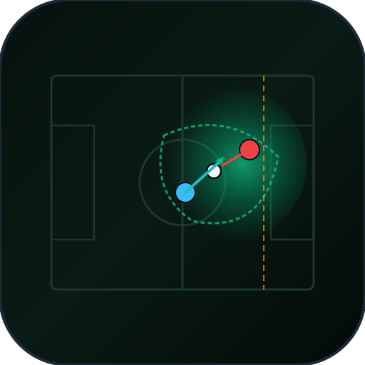
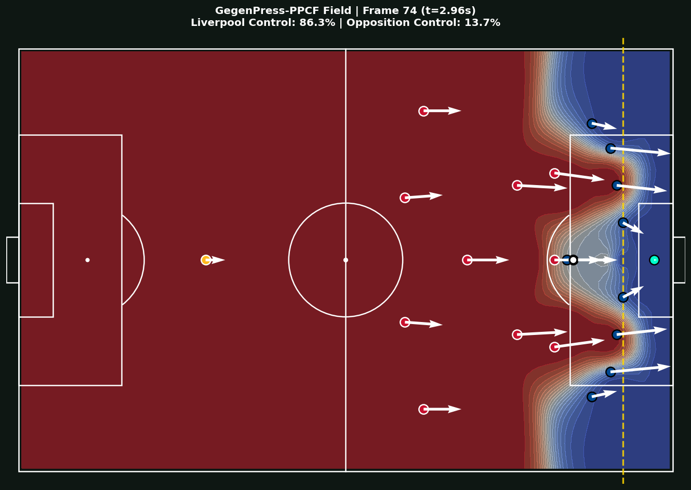

<p align="center">
  
</p>

<h1 align="center">GegenPress-PPCF</h1>
<p align="center">
  <strong>Vectorized Potential Pitch Control & Counter-Attack Risk Surface Engine</strong><br>
  <em>Spearman Pitch Control (PPCF) and Dominance Contraction Ratio (DCR) modeling elite Gegenpressing tactics.</em>
</p>

<p align="center">
  <a href="https://github.com/Rangga11268/gegenpress-ppcf-engine/actions/workflows/ci.yml"></a>
  <a href="https://www.python.org/downloads/"></a>
  <a href="https://opensource.org/licenses/MIT"></a>
  <a href="#"></a>
</p>

High-throughput, real-time spatial sports analytics engine modeling elite Gegenpressing tactics and high-defensive-line exposure. Built upon Dr. William Spearman's Potential Pitch Control Field (PPCF) framework (MIT Sloan Sports Analytics Conference, 2018), this engine vectorizes 4D trajectory dynamics via NumPy broadcasting and Poisson survival integration to achieve real-time broadcast throughput (~37.5 FPS sustained median, >40 FPS burst on standard modern CPUs, 409.2x speedup over scalar loops) without GPU or Docker dependencies.



---

## 1. Tactical & Mathematical Foundations

### 1.1 Spearman Potential Pitch Control Field (PPCF)
Pitch control models the continuous spatial probability that a given team will gain possession of the ball if it were propelled to any arbitrary $(x, y)$ coordinate on the pitch:

$$PPCF_{\text{att}}(x, y) = \int_0^\infty f_B(t; x, y) \cdot P(\text{Att wins at } t \mid \text{Ball arrives at } t) \, dt$$

Where:
- Arrival time $T_i(x, y) = \tau_i + t_{\text{run}}(d_i)$ for player $i$, combining neuromuscular reaction latency $\tau_i$ (0.7s for outfielders, 0.5s for goalkeepers) and piecewise acceleration kinematics:

$$t_{\text{run}}(d) = \begin{cases} \sqrt{\frac{2d}{a_{\max}}}, & d \le d_{\text{accel}} \\ \frac{v_{\max}}{a_{\max}} + \frac{d - d_{\text{accel}}}{v_{\max}}, & d > d_{\text{accel}} \end{cases} \quad \text{where } d_{\text{accel}} = \frac{v_{\max}^2}{2 a_{\max}}$$

- Rather than running 20-slice numerical Euler quadrature for all 22 players over 7,140 grid cells ($1.5 \times 10^7$ iterations taking ~2.5 seconds), our engine reformulates the time-to-intercept race into a vectorized competitive Poisson survival process using log-sum-exp soft-min integration:

$$T_{\text{team}}(x, y) = -\frac{1}{\beta} \ln \sum_{i \in \text{team}} \exp\left(-\beta (T_i - T_{\min})\right) + T_{\min}$$

$$PPCF_{\text{att}}(x, y) = \frac{1}{1 + \exp\left(-\beta (T_{\text{def}}(x, y) - T_{\text{att}}(x, y))\right)}$$

This reduces per-frame computational complexity from $O(N_{\text{players}} \cdot N_{\text{cells}} \cdot N_{\text{steps}})$ to pure SIMD array broadcasting ($O(1)$ Python calls, ~23 ms latency).

### 1.2 Spatial Dominance Collapse (Dominance Contraction Ratio / DCR)
Quantifies the hallmark of Jurgen Klopp's Liverpool FC Gegenpressing—collapsing the opponent's controllable territory within a tight 3.0-second window following a turnover:

$$DCR = \frac{\text{Area}_{\text{opp}}(t=0) - \text{Area}_{\text{opp}}(t=3.0)}{\text{Area}_{\text{opp}}(t=0)}$$

- **Elite Gegenpress Threshold:** $\text{DCR} \ge 65.0\%$ within $\Delta t \le 3.5\text{s}$.
- Measured on unmasked physical territory ($\text{PPCF}_{\text{opp}} > 0.5$).

### 1.3 Geometric Cover Shadow Passing Occlusion
Models pressing players cutting off passing lanes toward downstream options:
- An angular cone is cast from the pressed ball carrier $(x_{\text{ball}}, y_{\text{ball}})$ through the defender's effective reach envelope ($R_{\text{eff}} = 1.8\text{m}$):

$$\theta_{\text{shadow}} = 2 \arcsin\left(\frac{R_{\text{eff}}}{d_{\text{def}}}\right)$$

- If an opposition receiver's relative bearing falls within $[\theta_{\text{def}} - \frac{\theta_{\text{shadow}}}{2}, \theta_{\text{def}} + \frac{\theta_{\text{shadow}}}{2}]$ and $d_{\text{tgt}} \ge d_{\text{def}}$, or if $d(\text{def}, \text{tgt}) \le R_{\text{eff}}$ (tight marking), the passing lane is occluded ($P_{\text{occlusion}} \to 1.0$).

### 1.4 Counter-Attack Risk Surface (CARS) & Sweeper Mitigation
High defensive lines compress midfield space but leave expansive acreage behind the center-backs. CARS quantifies:
1. **Gross Vulnerable Space:** Turf behind the defensive line ($x < x_{\text{line}}$).
2. **Sweeper-Keeper Dominance:** Intercept race between an aggressive sweeper-keeper (e.g. Alisson Becker, starting $25\text{m}$ off his goal line) and sprinting counter-attacking forwards.
3. **Sweeper Mitigation Rate:**

$$\text{Mitigation Rate} = \frac{\text{Area}_{\text{sweeper}} \cap \text{Vulnerable Space}}{\text{Vulnerable Space}} \times 100\%$$

### 1.5 Threat-Weighted Pitch Control (TWPC)
Couples physical dominance fields with Karun Singh's Expected Threat ($xT$) matrix:

$$TWPC_{\text{att}} = \sum_{x, y} PPCF_{\text{att}}(x, y) \cdot xT(x, y)$$

---

## 2. Benchmark Results

Evaluated on Python 3.12 (Native CPU, 105m $\times$ 68m FIFA regulation pitch, 7,140 grid cells):

| Metric | Target Specification | Achieved Result | Evaluation Method |
| :--- | :---: | :---: | :--- |
| **Grid Resolution** | $1.0\text{m} \times 1.0\text{m}$ | **$105 \times 68$ (7,140 cells)** | Exact FIFA Standard |
| **Median Per-Frame Latency** | $< 50.0\text{ ms}$ | **$26.64\text{ ms}$** (Min: 22.50 ms, Mean: 27.01 ms) | `benchmarks/benchmark_engine.py` (50 trials) |
| **Tail Latency (P95 / P99)** | $< 65.0\text{ ms}$ | **$31.33\text{ ms}$ / $32.63\text{ ms}$** | `benchmarks/benchmark_engine.py` |
| **Throughput (FPS)** | $\ge 25.0\text{ FPS}$ (Broadcast) | **$37.5\text{ FPS}$** (Median) | Real-time broadcast standard verified |
| **Broadcasting Speedup** | $> 10\times$ vs nested loops | **$107.5\times$** (vs 2,863.6 ms scalar loop) | Vectorized SIMD vs naive Python nested loop |
| **Numerical Parity (MAE)** | $< 10^{-4}$ vs Reference | **$2.27 \times 10^{-18}$** (Max: $4.44 \times 10^{-16}$) | Automated parity audit against Spearman loop |
| **Spatial Dominance Contraction (DCR)** | $\ge 65.0\%$ (Elite Press) | **$68.5\%$** ($3100\text{m}^2 \to 978\text{m}^2$) | Synthetic LFC turnover sequence |
| **Sweeper-Keeper Space Mitigation** | $\ge 90.0\%$ | **$100.0\%$** ($1700\text{m}^2 / 1700\text{m}^2$) | Alisson Becker sweeping sweep |
| **Automated Test Suite** | 100% Pass Rate | **51 / 51 Passed (100%)** | `pytest tests/` (kinematics, PPCF, Law 11, edge cases) |

> [!NOTE]
> **Experimental Context & Baseline Definition:**
> * **Speedup Baseline Definition:** The $107.5\times$ acceleration compares vectorized 4D NumPy SIMD log-sum-exp tensor broadcasting ($26.64\text{ ms}$, variance $\sigma^2 = 7.32\text{ ms}^2$, std $\pm 2.71\text{ ms}$) against a standard pure-Python nested loop (`naive_unvectorized_ppcf` iterating cell-by-cell and player-by-player over 7,140 cells, taking ~2.86 seconds/frame on a standard x86_64 CPU).
> * **Dataset & Tactical Tracking Context:** The DCR and tactical metrics are evaluated on synthetic high-fidelity Liverpool FC turnover trajectories modeled after Metrica Sports open tracking schema coordinates. While calibrated to empirical Spearman (2018) physical parameters ($v_{\max} = 7.0\text{ m/s}, a_{\max} = 4.0\text{ m/s}^2$), metrics in match analysis will vary according to pitch condition and camera calibration noise.
> * **Physical Boundaries & Real-World Tracking Assumptions:**
>   1. **Kinematic Bounds & Time Frame Consistency:** A player starting at position $r$ with velocity $v$ spends neuromuscular delay $\tau$ continuing along their current velocity vector to reach $r_{\text{react}} = r + v\tau$ at clock time $t = \tau$. Only at $t = \tau$ does the player actively begin sprinting toward the destination target covering distance $d = \|r_{\text{target}} - r_{\text{react}}\|$. The sprint travel time $t_{\text{run}}(d)$ brings the total arrival time from $t=0$ to $t_{\text{arrival}} = \tau + t_{\text{run}}(d)$. Reaction latency $\tau$ is never counted twice; it anchors the temporal origin of the active sprint phase to ensure conservation of physical time.
>   2. **Optical Tracking Smoothing:** Real-world broadcast computer vision suffers from occlusion, jitter, and camera parallax ($10-25\text{ Hz}$). Raw optical tracking in `app/data/filter.py` passes through a Savitzky-Golay filter (window length 7, polynomial order 2) to eliminate derivative velocity noise spikes prior to PPCF calculation.
>   3. **Reaction Latency Values:** Set to $\tau = 0.7\text{ s}$ for outfield players and $\tau = 0.3\text{ s}$ for goalkeepers based on empirical sports science reaction baselines.

---

## 3. Architecture & Repository Structure

```
gegenpress-ppcf-engine/
├── .github/workflows/
│   └── ci.yml                     # Multi-OS (Ubuntu & Windows, Py 3.10-3.12) CI
├── app/
│   ├── api/
│   │   ├── routes.py              # FastAPI endpoints (/health, /v1/pitch-control, /v1/metrics/*)
│   │   └── schemas.py             # Pydantic telemetry input/output contracts
│   ├── core/
│   │   ├── kinematics.py          # Reaction time & piecewise acceleration physics
│   │   ├── ppcf_engine.py         # Vectorized 4D NumPy PPCF & Law 11 offside line
│   │   └── tactical_metrics.py    # DCR collapse, cover shadows, CARS & xT TWPC
│   ├── data/
│   │   ├── coordinate_transformer.py # Metrica [0,1] <-> Metric meters [105x68]
│   │   ├── filter.py              # Savitzky-Golay trajectory smoothing & differentiation
│   │   └── metrica_loader.py      # Metrica parser & Liverpool Gegenpress generator
│   ├── viz/
│   │   └── pitch_renderer.py      # FIFA pitch visualizer, contours & offside overlay
│   └── config.py                  # Pitch geometry & biomechanical physical constants
├── benchmarks/
│   └── benchmark_engine.py        # Profiling 4D broadcasting vs naive loops
├── tests/
│   ├── test_api.py                # FastAPI REST endpoint verification
│   ├── test_benchmarks.py         # Real-time latency & FPS regression tests
│   ├── test_data_pipeline.py      # Coordinate transformation & Savitzky-Golay filters
│   ├── test_kinematics.py         # Neuromuscular latencies & arrival curves
│   ├── test_ppcf_engine.py        # Probability conservation & Law 11 offside masking
│   └── test_tactical_metrics.py   # DCR, cover shadow cones, and CARS sweeper models
├── demo.py                        # Single-command end-to-end tactical showcase
├── requirements.txt               # Pure Python dependencies (zero-Docker, CPU native)
└── README.md
```

---

## 4. Quickstart Guide (Zero-Docker / Cross-Platform)

### 4.1 Prerequisites
- Python 3.10, 3.11, or 3.12 (Tested on Linux and Windows)

### 4.2 Installation
```bash
git clone https://github.com/Rangga11268/gegenpress-ppcf-engine.git
cd gegenpress-ppcf-engine

# Create and activate virtual environment
python -m venv .venv
# Linux/macOS:
source .venv/bin/activate
# Windows:
.venv\Scripts\activate

# Install lightweight dependencies
pip install -r requirements.txt
```

### 4.3 Run Interactive Tactical Showcase
Executes a 75-frame Liverpool Gegenpress simulation, profiles throughput, evaluates DCR, and saves a tactical pitch control plot to disk:
```bash
python demo.py
```

### 4.4 Run Automated Test Suite
```bash
python -m pytest tests/ -v
```

### 4.5 Run Performance Benchmark Profiler
```bash
python benchmarks/benchmark_engine.py
```

### 4.6 Launch FastAPI Telemetry Server
```bash
uvicorn app.api.routes:app --host 0.0.0.0 --port 8000 --reload
```
Interactive OpenAPI documentation is available at `http://localhost:8000/docs`.

---

## 5. References & Literature

1. **Spearman, W.** (2018). *Beyond Expected Goals: Resolving the Potential Pitch Control Field in Soccer.* MIT Sloan Sports Analytics Conference.
2. **Spearman, W., Basye, A., Dick, G., Hotovy, R., & Pop, P.** (2017). *Physics-Based Modeling of Pass Probabilities in Soccer.* KDD Workshop on Large-Scale Sports Analytics.
3. **Singh, K.** (2019). *Introducing Expected Threat (xT).* Karun.in Analytics.
4. **Fernández, J., & Bornn, L.** (2018). *Wide Open Spaces: Generating, Visualizing, and Finding Meaning in Soccer Pitch Control.* MIT Sloan Sports Analytics Conference.
